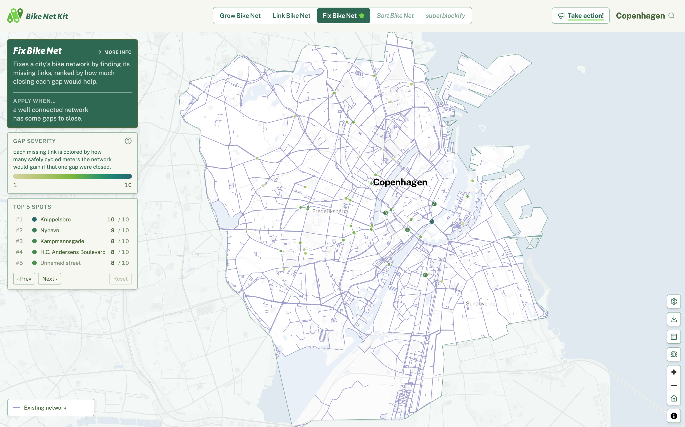
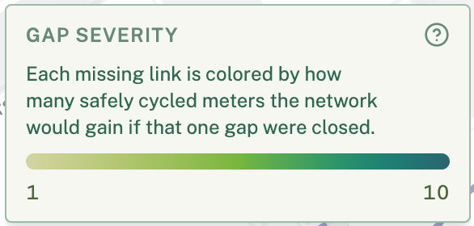
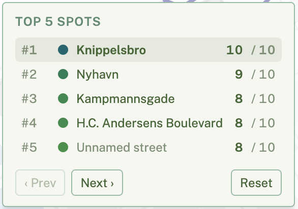
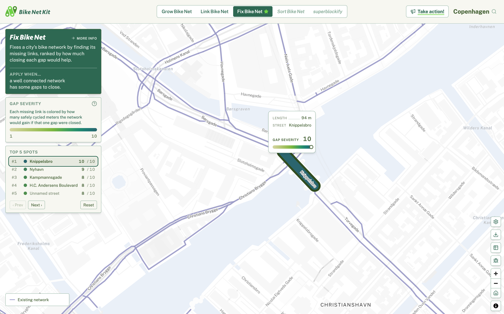

{ width=50% }

Source: [https://github.com/BikeNetKit/tutorials/tree/main/bikenetkit.org/fixbikenet/](https://github.com/BikeNetKit/tutorials/tree/main/bikenetkit.org/fixbikenet/)

Created 2026-11-17 by Michael Szell: contact@bikenetkit.org

# Tutorial

Welcome to the tutorial for FixBikeNet, part of BikeNetKit - The digital toolkit for bicycle networks.

This tutorial shows you how to use the visualization at [bikenetkit.org](https://bikenetkit.org/fixbikenet/copenhagen_dk), and what you can get out of it. We demonstrate FixBikeNet for the example city of Copenhagen, the capital of Denmark (where also FixBikeNet was developed).

# Setup

First, go to [https://bikenetkit.org/fixbikenet/copenhagen_dk](https://bikenetkit.org/fixbikenet/copenhagen_dk). The map looks like this:  
{width=100%}

# Exploring the map
## When to use FixBikeNet
The green star next to the tool name in the top bar means that we recommend using FixBikeNet for Copenhagen, because its existing bicycle network is well developed. FixBikeNet works particularly well for such cities.

## Existing bicycle network
In the middle of the map you see the city. By default you see the existing network of protected bicycle infrastructure in purple. Protected bike infrastructure is any infrastructure where cyclists can cycle safely - this usualy means no mixing with cars. For example car-free streets, paths inside parks, or curb-raised protected bike lanes.

## Gaps to fill
The job of FixBikeNet is to find the top gaps to fill, to bring the most benefits to cyclists - the most expected cycled meters per meter of gap closed. This benefit is measured by the gap severity, where 10 shows the most important gaps. 

{width=586px}

On the map you can see the top 50 gaps highlighted as green circles. The top 5 are highlighted with a bigger circle and their rank (1 to 5). In cities like Copenhagen that have bridges without protected bicycle infrastructure, often these bridges are the top gaps, because they connect large parts of the city, so of course many cyclists will cycle over the bridges.

# Inspecting the top gaps
By clicking on `Knippelsbro`, the first row in the `TOP 5 SPOTS` table on the left, you zoom to the top gap Knippelsbro, which is one of the main bridges of the city that does only have a painted bike lane but no protected bicycle infrastructure. 

{width=586px}

{width=100%}

Hovering over the gap shows you it is 94m long. To see the next gap, press `Next` in the table, and it will bring you to the top 2 spot. Pressing `Next` repeatedly lets you cycle through all top 50 gaps. 

# Takeaway
In the end, what can you do with all this? 

*As a planner*, you get a data-informed, quick way of identifying the most important gaps in your bicycle network, by the number of cyclist meters per filled gap meter that you would make safe for cyclists. The underlying Python software can be configured with many more custom settings and data imports. It can also export data, which you can refine further with a GIS application like QGIS.

*As a citizen*, if you want your city to improve cycling, we provide a `Take action!` button on top right that takes you to your city's cycling initiatives, to the contact page of your city and your transport ministry, and to your local cycling organization which works hard to bring political change for better cycling infrastructure.

{width=260px}
