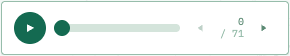
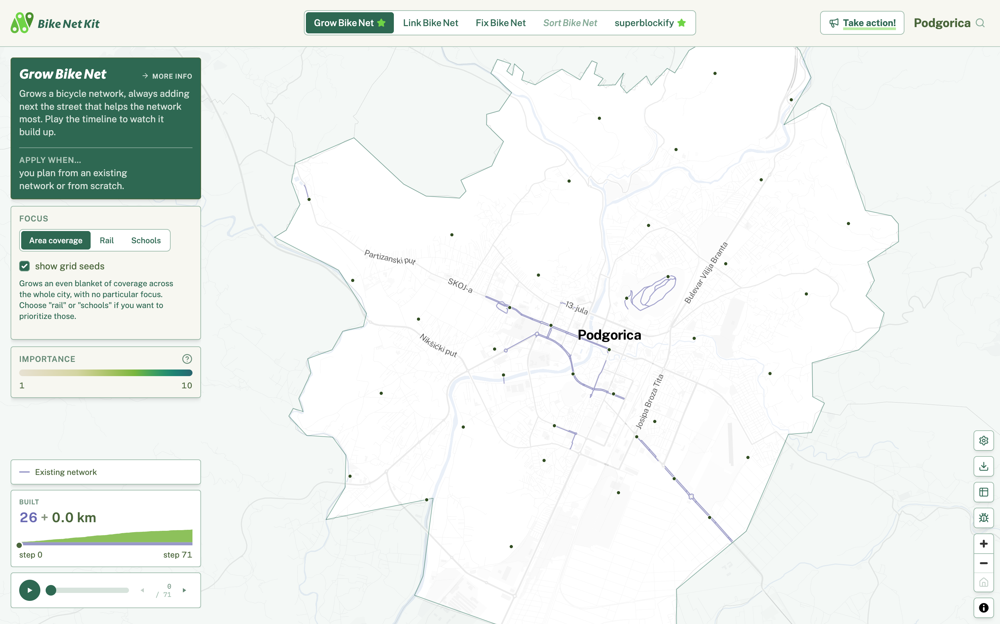
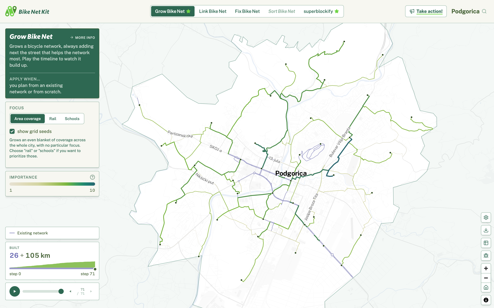
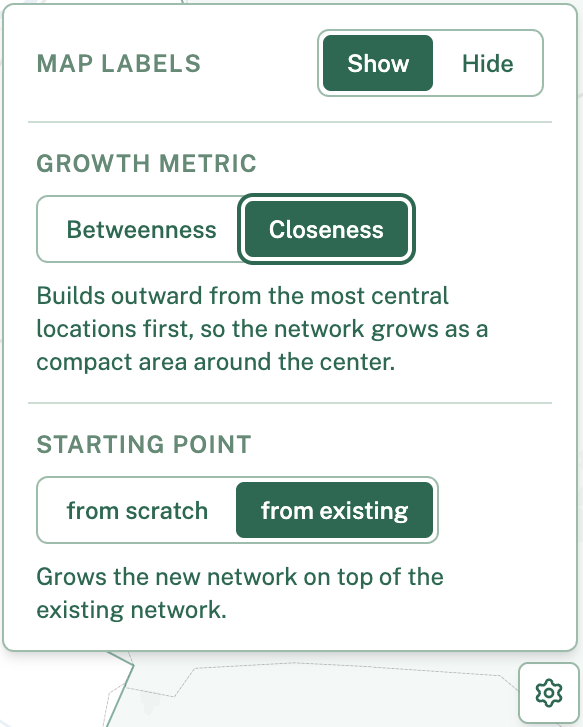
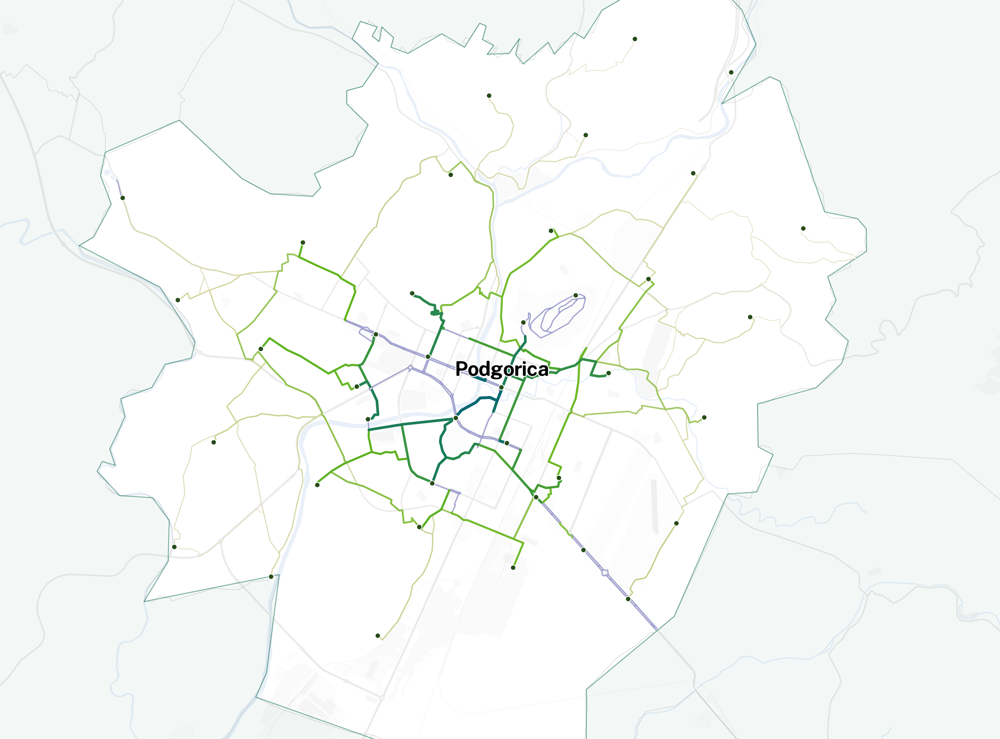
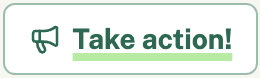

{ width=50% }

Source: [https://github.com/BikeNetKit/tutorials/tree/main/bikenetkit.org/growbikenet.md](https://github.com/BikeNetKit/tutorials/tree/main/bikenetkit.org/growbikenet.md)

Created 2026-10-22 by Michael Szell: contact@bikenetkit.org

# Tutorial

Welcome to the tutorial for GrowBikeNet, part of BikeNetKit - The digital toolkit for bicycle networks.

This tutorial shows you how to use the visualization at [bikenetkit.org](https://bikenetkit.org/growbikenet/podgorica_me), and what you can get out of it. We demonstrate GrowBikeNet for the example city of Podgorica, the capital of Montenegro.

# Setup

First, go to [https://bikenetkit.org/growbikenet/podgorica_me](https://bikenetkit.org/growbikenet/podgorica_me). Pull the play bar on the bottom back to zero. This resets the visualization:  
{width=290px}

The map now looks like this:  
{width=100%}

# Exploring the map
## When to use GrowBikeNet
The green star next to the tool name in the top bar means that we recommend using GrowBikeNet for Podgorica, because its existing bicycle network is not well developed. GrowBikeNet works particularly well for such cities.

## Existing bicycle network
In the middle of the map you see the city. By default you see the existing network of protected bicycle infrastructure in purple. If you hover over it, you can see its length - 26km. It is also reported in the `BUILT` window above the play bar. Protected bike infrastructure is any infrastructure where cyclists can cycle safely - this usualy means no mixing with cars. For example car-free streets, paths inside parks, or curb-raised protected bike lanes.

## Seed points
You also see the so-called seed points which are by default placed on a grid covering the whole city. These are points that your network should grow towards, and they could be anything from rail stations, schools, or other poihnts of interests. They are snapped to the existing bicycle network pieces and to the closest intersections in the street network.

You can actually change them to rail stations or schools here on the left side in the `FOCUS` window. If you do that, you will see the points updating on the map, and you also see grey icons popping up showing the rail stations and schools. 

Growing the network towards schools is in general a good way of restricting growth to populated areas, while growing towards rail stations follows a transit-oriented urban development. The underlying Python package GrowBikeNet allows you to set seed points to any kind of custom points.

# Growing the network
Go back to the default `Area coverage` focus. You can now let the network grow step by step by pressing the play button on the bottom left. You can see green links added step by step. These are the suggested streets that should be turned into protected infrastructure:

{width=100%}

You can see that it built up from a starting length of 26 km, and it added 105 km on top of it. Now, you can replay, pause, and use your left and right arrow keys to inspect each growth step. 

## Growing by betweenness
You can see that the links are colored by importance. The most important links are being added first. They are by default ordered by so-called betweenness centrality, which is a network measure giving a proxy for cyclist flows. This means that you build up first those corridors where you expect more cyclists, just from the structure of the network. 

Our research showed that growing the networks ordered by betweenness will lead to a well functioning early network structure. The underlying Python package GrowBikeNet allows you to import mobility data that can reprioritize the links.

## Growing by closeness
You can change to order not by betweenness, but by so-called closeness centrality. Press the settings button on the right, and select `Closeness` under `GROWTH METRIC`. 

{width=583px}

Closeness builds outward from the most central locations first, so the network grows as a compact area around the center. Growing form the center can make sense here in Podgorica, as you consolidate the existing network which is mostly in the center. But usually betweenness is better.

Explore how the network grows by closeness:  
{width=100%}

## Growing from scratch
As a starting point you can also grow from scratch. In the settings, press `from scratch` under `STARTING POINT`, and GrowBikeNet will ignore all existing bike infrastructure. This can be useful if there is very little there in the first place.

# Takeaway
In the end, what can you do with all this? 

*As a planner*, you get a data-informed, quick way of building up a well-connected bicycle network. The underlying Python software can be configured with many more custom settings and data imports. It can also export data, which you can refine further with a GIS application like QGIS.

*As a citizen*, if you want your city to improve cycling, we provide a `Take action!` button on top right that takes you to your city's cycling initiatives, to the contact page of your city and your transport ministry, and to your local cycling organization which works hard to bring political change for better cycling infrastructure.

{width=260px}
