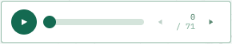
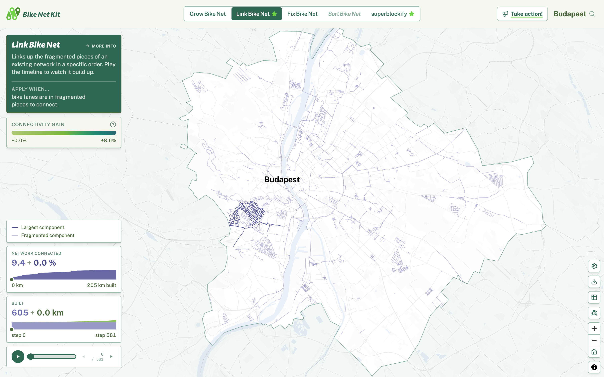
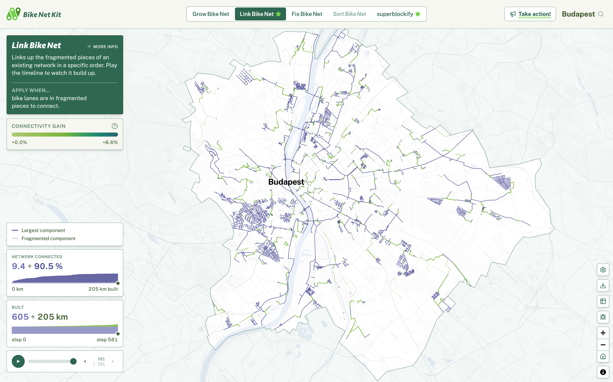
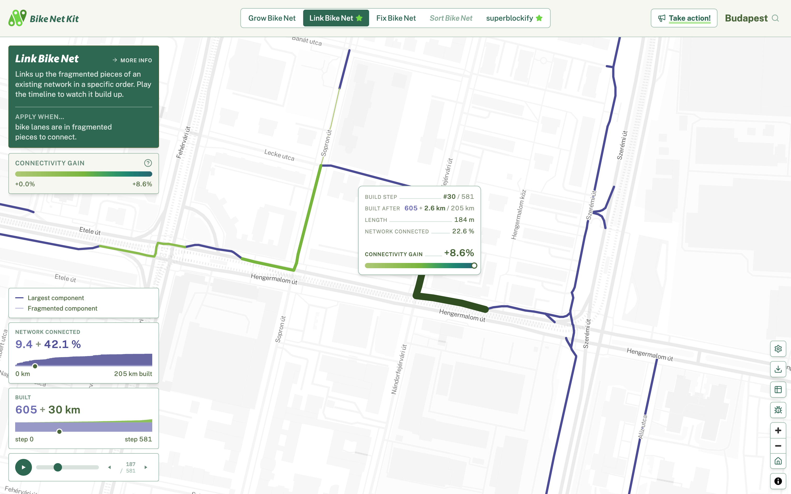
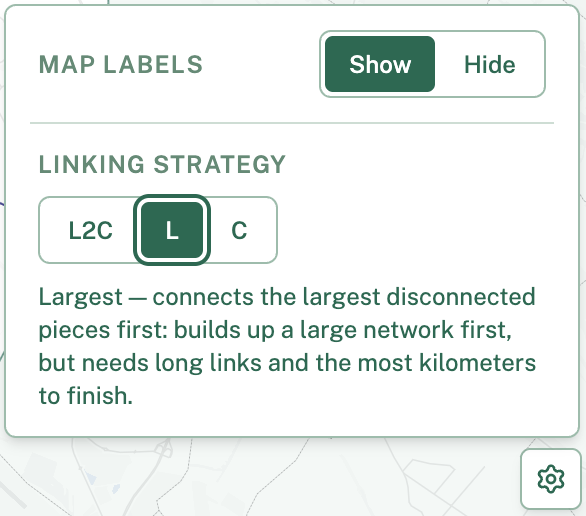
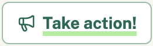

{ width=50% }

Source: [https://github.com/BikeNetKit/tutorials/tree/main/bikenetkit.org/linkbikenet/](https://github.com/BikeNetKit/tutorials/tree/main/bikenetkit.org/linkbikenet/)

Created 2026-11-17 by Michael Szell: contact@bikenetkit.org

# Tutorial

Welcome to the tutorial for LinkBikeNet, part of BikeNetKit - The digital toolkit for bicycle networks.

This tutorial shows you how to use the visualization at [bikenetkit.org](https://bikenetkit.org/linkbikenet/budapest_hu), and what you can get out of it. We demonstrate LinkBikeNet for the example city of Budapest, the capital of Hungary.

# Setup

First, go to [https://bikenetkit.org/linkbikenet/budapest_hu](https://bikenetkit.org/linkbikenet/budapest_hu). Pull the play bar on the bottom back to zero. This resets the visualization:  
{width=290px}

The map now looks like this:  
{width=100%}

# Exploring the map
## When to use LinkBikeNet
The green star next to the tool name in the top bar means that we recommend using LinkBikeNet for Budapest, because its existing bicycle network is developed to some point, but into hundreds of fragmented pieces. LinkBikeNet works particularly well for such cities.

## Existing bicycle network
Protected bike infrastructure that makes up a bicycle network is any infrastructure where cyclists can cycle safely - this usualy means no mixing with cars. For example car-free streets, paths inside parks, or curb-raised protected bike lanes.

In the middle of the map you see the city. By default you see the existing network of protected bicycle infrastructure in purple. It is divided into a dark purple and a light purple part. The dark purple part is the so-called "Largest connected component". These are all the segments in the network that belong to the largest connected fragment. 

The whole bicycle network is 605km long, reported in the `BUILT` window above the play bar. However, the larget component only makes up 9.4% of the whole network which shows how disconnected this network is. 

The job of LinkBikeNet is to find those tiny connector pieces that link together the disconnected, fragmented components to make a whole network. Our research shows that it takes only tiny pieces for a huge gain.

# Linking the network
You can now let the network be linked up step by step by pressing the play button on the bottom left. You can see green links added step by step. These are the suggested streets that should be turned into protected infrastructure:

{width=100%}

At the same time, the dark purple part grows step by step, until reaching 100% of the network. In the end it has connected 581 pieces with 580 connectors, and it has added in total 205 extra kilometers on top of the 605, and it has turned the largest connected piece from 9.4% to 100%. 

Our research shows that you only need a tiny amount of kilometers to get huge gains. If we add only 30km, from 605 to 635km - almost nothing - we turn the 9% largest component to 50%. 

The connectors are displayed in green. The darker, the more connectivity gains it brings to the network. This tiny piece of 184m adds 8.6% to the largest component.

{width=100%}

## Linking largest to closest
By default, the added links are ordered by connecting the largest piece to the closest piece, step by step.

## Linking largest to second largest
You can change to link not largest to closest pieces, but largest to second largest. Press the settings button on the right, and select `L` under `LINKING STRATEGY`. 

{width=586px}

This strategy connects the largest disconnected pieces first: It builds up a large network first, but needs long links and the most kilometers to finish. Explore how the network grows by linking largest to second largest pieces. You notice some long green links added, because largest and second largest pieces can be far apart in the city.  

## Linking closest components
The last strategy is linking closest components. Here, the closest pieces are linked first, no matter how large they are, or whether they are part of the largest component already. This will create a lot of short links and the fewest total kilometers to finish, but delays the buildup of a large network.

If we run this strategy, not much happens for a long time, but then suddenly there is a big transition - a percolation - and we have built up the whole network with only 210 added kilometers.

# Takeaway
In the end, what can you do with all this? 

*As a planner*, you get a data-informed, quick way of identifying those tiny connecting pieces that will grow the largest connected component of your bicycle network fast. The underlying Python software can be configured with many more custom settings and data imports. It can also export data, which you can refine further with a GIS application like QGIS.

*As a citizen*, if you want your city to improve cycling, we provide a `Take action!` button on top right that takes you to your city's cycling initiatives, to the contact page of your city and your transport ministry, and to your local cycling organization which works hard to bring political change for better cycling infrastructure.

{width=260px}
