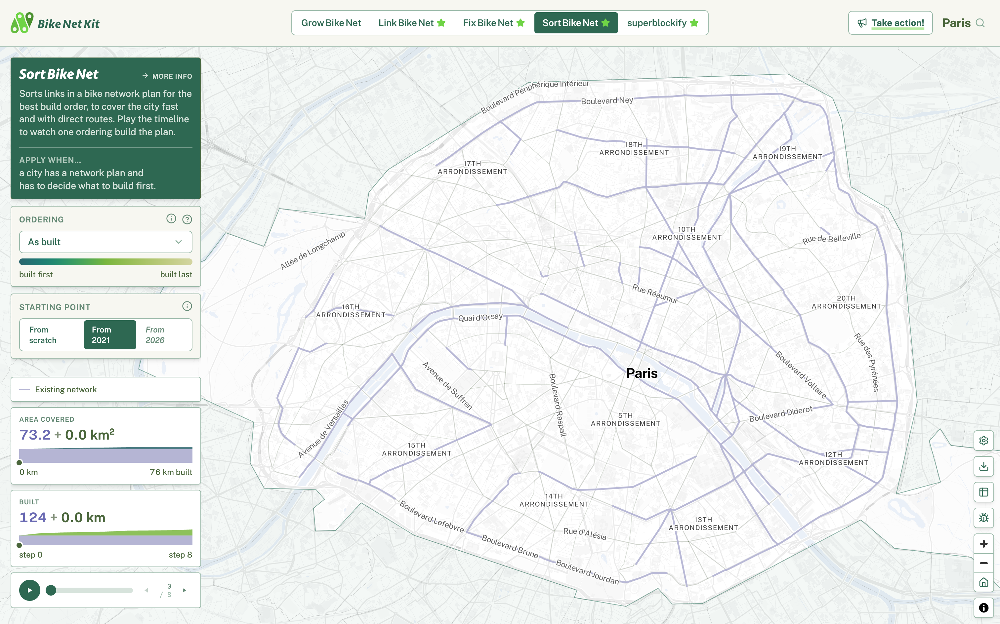
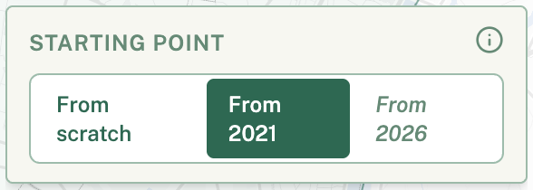
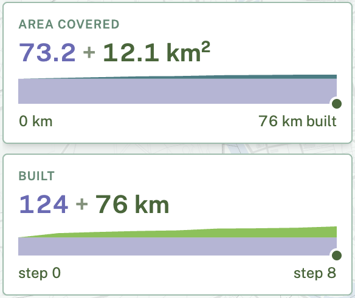
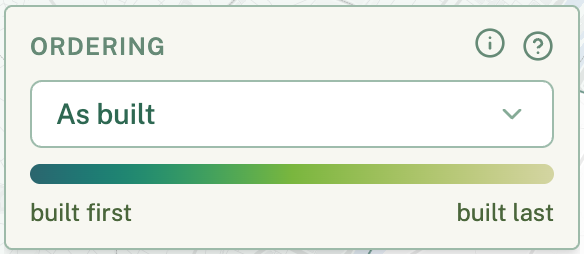
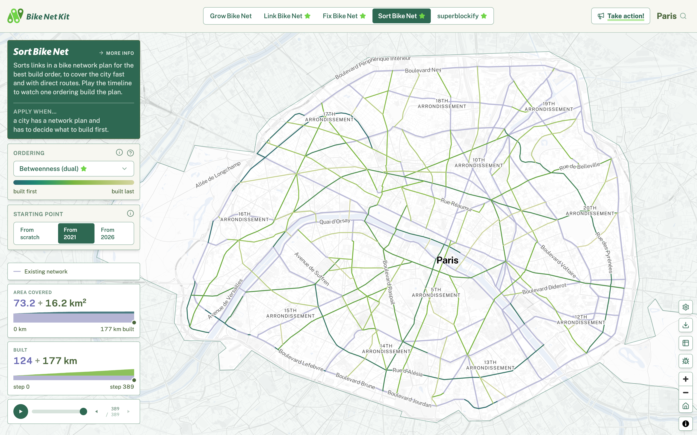
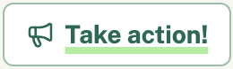

{ width=50% }

Source: [https://github.com/BikeNetKit/tutorials/tree/main/bikenetkit.org/sortbikenet/](https://github.com/BikeNetKit/tutorials/tree/main/bikenetkit.org/sortbikenet/)

Created 2026-11-20 by Michael Szell: contact@bikenetkit.org

# Tutorial

Welcome to the tutorial for SortBikeNet, part of BikeNetKit - The digital toolkit for bicycle networks.

This tutorial shows you how to use the visualization at [bikenetkit.org](https://bikenetkit.org/sortbikenet/paris_fr/real/from_2021), and what you can get out of it. We demonstrate SortBikeNet for the example city of Paris, the capital of France.

# What SortBikeNet does and why it works only in Paris

SortBikeNet only works in Paris because it is the only city where we have workable data available, for a planned bike network which Paris planned and built partially from 2021 to 2026.

SortBikeNet tackles the ordering problem, where given a bicycle network plan that should be built, in what order should the segments be constructed to arrive at a functional network as soon as possible already while building the network.

Why only Paris? We found no city in Europe that publishes data that could be analyzed. Luckily, in Paris there is the NGO "Paris en Selle" that collected and published this data.

# Setup

First, go to [https://bikenetkit.org/sortbikenet/paris_fr/real/from_2021](https://bikenetkit.org/sortbikenet/paris_fr/real/from_2021). Pull the play bar on the bottom back to zero. This resets the visualization:  
{width=580px}

The map now looks like this:  
{width=100%}

# Exploring the map
## Existing bicycle network
In the middle of the map you see the city. By default you see the existing network of protected bicycle infrastructure in purple. Protected bike infrastructure is any infrastructure where cyclists can cycle safely - this usualy means no mixing with cars. For example car-free streets, paths inside parks, or curb-raised protected bike lanes.

## Points in time
We have three main points in time with data available. `From 2021` is marked in the `STARTING POINT` window, where the existing bike network had a length of 124km. If you press `From 2026`, you see that after five years Paris has built 76km, reaching 200km. It wanted to build 100km more but did not manage. Now press again `From 2021`.

{width=588px}

## Exploring real growth
We can now show how Paris has actually built its network, and compare that to simulations how it could have built the network to arrive at fuctionality much earlier, so that cyclists could have enjoyed not just after five years the features of the network, but maybe after one year.

The main features we focus on are the area covered and directness. Area covered means, if you imagine a small buffer around all of the links, then how large is the area covered by all the link buffers. Ideally the links should be placed in a way that they cover the whole city in the end. You can see in 2021, when the network's length was 124km, its area covered was 73km$^2$. In 2026 it was 85km$^2$.

{width=584px}

In the `ORDERING` window above, select `As built` now. This means that the data that Paris en Selle collected in time is shown, displaying how Paris has actually built its network from 2021. Press the Play button to see the 8 collected steps in time of how the network has grown up to 200km. 

In our research we show that this was a suboptimal way of growing the network. It leaves open a lot of gaps, which is measured with the directness metric. This metric measures how direct the routes are on the whole network. The more direct, the better because cyclists are not forced to take large detours. 

To summarize, you want both early directness and coverage of the city.

## Exploring a synthetic ordering
Now we can explore what were to happen if Paris would have built the planned links in a different order. There are many strategies that we have researched. We found the top two strategies that improve both coverage and directness when compared to real growth are Dual betweenness and Hierarchy-coverage growth.

{width=584px}

Reset the Play button back to zero, select `Betwenness (dual)` in the `ORDERING` window, and press the Play button. Now the network grows until the end of the plan, until the finished 300km. The colors of the links show which are built first - the darker the earlier. You can see how this strategy tries to connect full paths and not leave open gaps, which is why it is better in terms of directness.

{width=100%}

Play around with other strategies and think how you would order the links yourself. You can find more information in our scientific paper what these strategies mean.

# Takeaway
In the end, what can you do with all this? 

*As a planner*, you get a data-informed way of best ordering links to build in a bicycle network plan. The underlying Python software can be configured with many more custom settings and data imports. It can also export data, which you can refine further with a GIS application like QGIS.

*As a citizen*, if you want your city to improve cycling, we provide a `Take action!` button on top right that takes you to your city's cycling initiatives, to the contact page of your city and your transport ministry, and to your local cycling organization which works hard to bring political change for better cycling infrastructure.

{width=260px}
