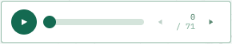
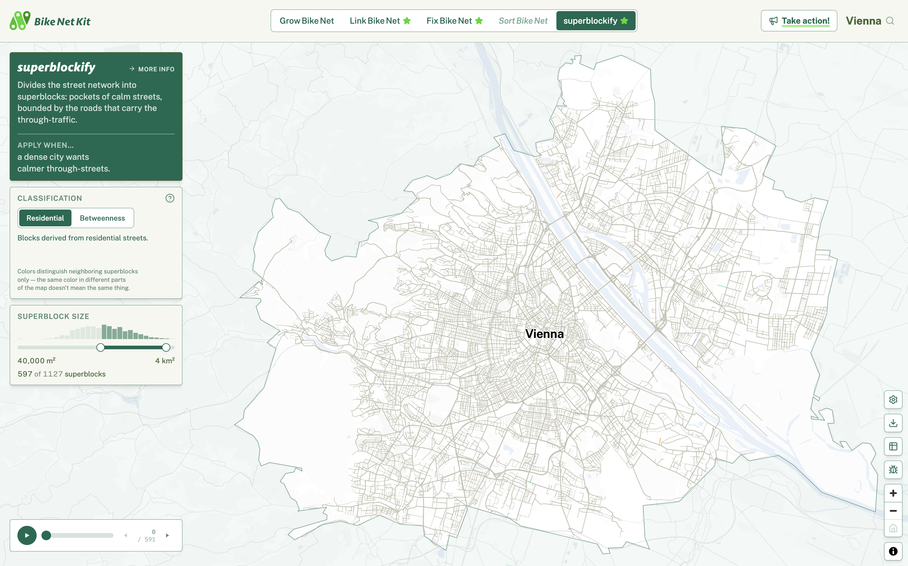
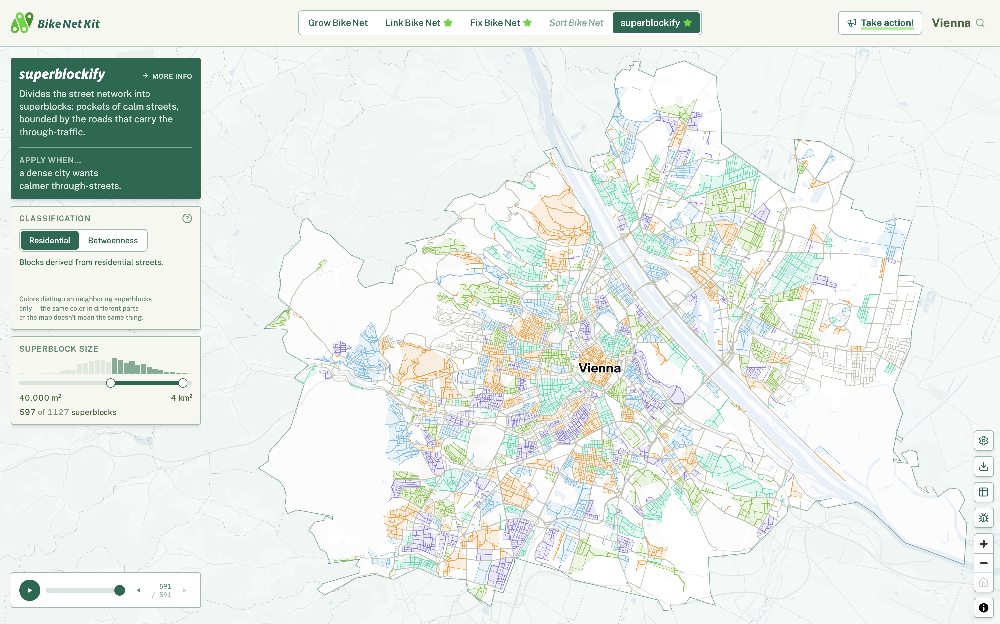
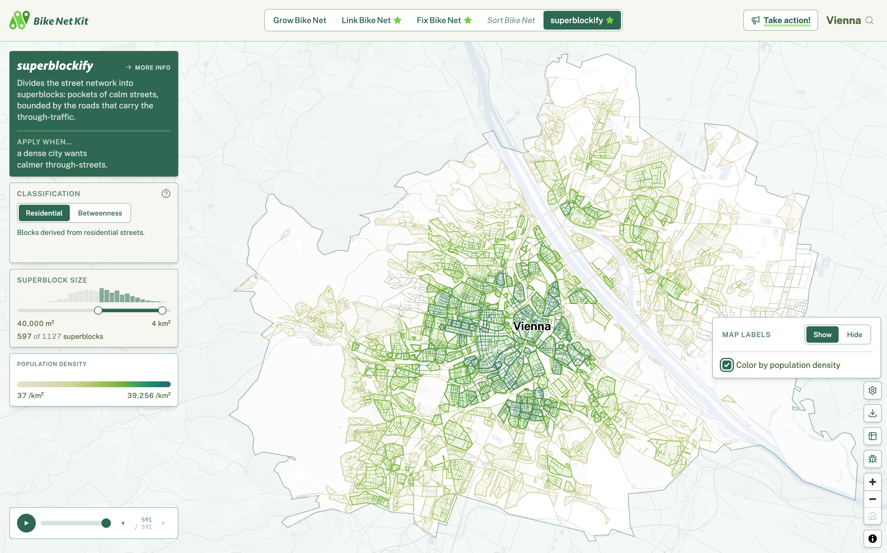
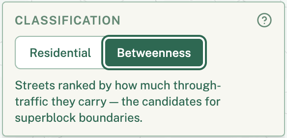
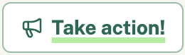

{ width=50% }

Source: [https://github.com/BikeNetKit/tutorials/tree/main/bikenetkit.org/superblockify/](https://github.com/BikeNetKit/tutorials/tree/main/bikenetkit.org/superblockify/)

Created 2026-11-17 by Michael Szell: contact@bikenetkit.org

# Tutorial

Welcome to the tutorial for superblockify, part of BikeNetKit - The digital toolkit for bicycle networks.

This tutorial shows you how to use the visualization at [bikenetkit.org](https://bikenetkit.org/superblockify/vienna_at), and what you can get out of it. We demonstrate superblockify for the example city of Vienna, the capital of Austria.

# What is a Superblock?
A Superblock is a neighborhood of calm streets, where cars are not allowed to drive through; they are only allowed to start or end their journey there. This creates calm neighborhoods where it is much safer to walk, play, or to cycle. The name "Superblock" comes from Barcelona, but it comes in many different names and flavors depending on the country. For example, in the UK it is called Low Traffic Neighborhood, in Denmark it is called Trafikø, or in Vienna it is called Supergrätzl.

# Setup

First, go to [https://bikenetkit.org/superblockify/vienna_at](https://bikenetkit.org/superblockify/vienna_at). Pull the play bar on the bottom back to zero. This resets the visualization:  
{width=290px}

The map now looks like this, showing the street network in grey:
{width=100%}

# Superblockifying the city
Pressing the play button shows the suggested, potential Superblocks for the city that it could implement - around 600.

{width=100%}

The colors just distinguish neighboring Superblocks. The order in which the play button builds up the Superblocks is by population density. The idea is to get the most out of a limited budget for the most people in the smallest area. To see the population density, press the Settings button and select `Color by population density`.

{width=100%}

Dark green Superblocks are those with highest population density. These are maybe the first candidates for Superblocks. Now let's deselect the last box and color them in the original way. 

There is a filter for Superblock size in the `SUPERBLOCK SIZE` window on the left. By default the visualization filters for sizes between 40000m2 and 4km2, with the idea being that if you imagine a Superblock as a square, then it has a side length between 200m and 2km. These sizes make most sense for Superblocks, but you can use the filter to show smaller or larger ones. You can also click `Reset` to the original setting.

## Residential partitioning
How did superblockify find these potential Superblocks? In this default case of the residential partitioning, it used OpenStreetMap's underlying data. People tagged the streets as either residential or not residential. Superblockify tries to cluster the residential streets, and as the outer streets around the Superblocks it tries to use the non-residential streets.

## Betweenness partitioning
An alternative partitioner is the betweenness partitioner. Press `Betweenness` in the `CLASSIFICATION` window.

{width=584px}

This partitioner produces a bit fewer and larger Superblocks. Here, the streets are ranked by the street network's structure, estimating through traffic. The streets with highest estimated through traffic should become boundaries, streets with low through traffic should become the insides of Superblocks. 

# Takeaway
In the end, what can you do with all this? 

*As a planner*, you get a data-informed, quick way of suggested potential Superblocks in your city, prioritized by population density. The underlying Python software can be configured with many more custom settings and data imports. It can also export data, which you can refine further with a GIS application like QGIS.

*As a citizen*, if you want your city to improve cycling, we provide a `Take action!` button on top right that takes you to your city's cycling initiatives, to the contact page of your city and your transport ministry, and to your local cycling organization which works hard to bring political change for better cycling infrastructure.

{width=260px}
